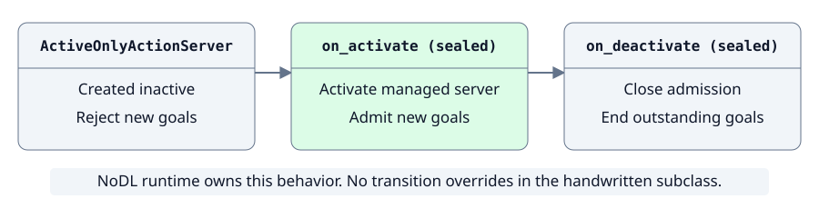
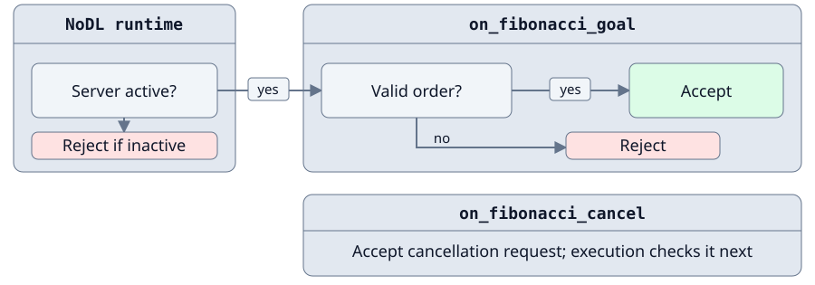
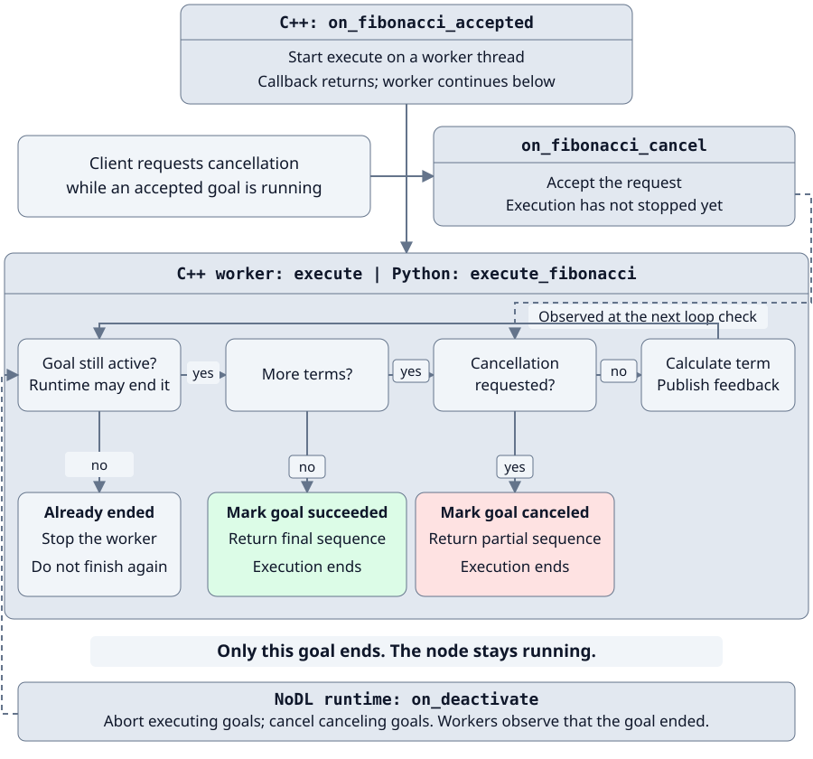

# Build a lifecycle action server in C++ and Python

Define a Fibonacci action once, generate a lifecycle base for either language, then add the application behavior.

:::{warning}
This follow-up targets the proposed lifecycle runtimes in [C++ PR 275](https://github.com/ros-tooling/nodl/pull/275) and
[Python PR 277](https://github.com/ros-tooling/nodl/pull/277), including their prerequisite stacks.
Build against both dependencies; this behavior is not yet available on `main`.
:::

> **Shared contract → Generated base → Lifecycle subclass → Conform**

Choose C++ or Python in any language tab.
The browser remembers the selection for the other grouped tabs on this page.

The handwritten subclasses keep the calculation and callback structure familiar from the official
[`examples_rclcpp_minimal_action_server`](https://github.com/ros2/examples/tree/rolling/rclcpp/actions/minimal_action_server)
and
[`examples_rclpy_minimal_action_server`](https://github.com/ros2/examples/tree/rolling/rclpy/actions/minimal_action_server).
No existing server is required; this tutorial starts from the interface contract.

## 1. Define one public action contract

Begin with the language-neutral public interface:

```{literalinclude} ../../../examples/nodl_tutorials/lifecycle_action/nodl/fibonacci.nodl.yaml
:language: yaml
```

Only this file is public and registered.
The shared lifecycle provider supplies both languages' base-class metadata and lifecycle interfaces.
The generated runtime rejects inactive goals and ends outstanding goals on deactivation.
The application supplies validation, calculation, feedback, and cooperative execution.
The relative `fibonacci` name follows the upstream examples and remains namespace- and remap-friendly.
In the root namespace it appears as `/fibonacci` on the ROS graph.

## 2. Register the contract and generate a base

Choose one package: C++ or Python.
Each has its own complete `CMakeLists.txt` and builds independently using the shared `fibonacci.nodl.yaml`.
Its generator call both creates the base and registers the contract as the package's `fibonacci` resource.

:::::{tabs}
::::{group-tab} C++

**`cpp/CMakeLists.txt`** — the C++ build path, with its NoDL additions highlighted:

```{literalinclude} ../../../examples/nodl_tutorials/lifecycle_action/cpp/CMakeLists.txt
:language: cmake
:lines: 4-19
:lineno-match:
:emphasize-lines: 4-5,7-10,13
```

This generates a lifecycle node with `on_fibonacci_goal`, `on_fibonacci_cancel`, and `on_fibonacci_accepted`
callbacks.

:::{note}
:collapsible: closed
:title: Generated C++ base

```{literalinclude} ../../../examples/nodl_tutorials/lifecycle_action/test/expected/generated_cpp.txt
:language: cpp
```

:::

::::
::::{group-tab} Python

**`python/CMakeLists.txt`** — the Python build path, with its NoDL additions highlighted:

```{literalinclude} ../../../examples/nodl_tutorials/lifecycle_action/python/CMakeLists.txt
:language: cmake
:lines: 4-17
:lineno-match:
:emphasize-lines: 4-5,7-10
```

This generates a lifecycle node with `on_fibonacci_goal`, `on_fibonacci_cancel`, and `execute_fibonacci` callbacks.

:::{note}
:collapsible: closed
:title: Generated Python base

```{literalinclude} ../../../examples/nodl_tutorials/lifecycle_action/test/expected/generated_python.txt
:language: python
```

:::

::::
:::::

## 3. Implement behavior on the managed lifecycle server

Each complete server fits in one short source file:
{download}`C++ source <../../../examples/nodl_tutorials/lifecycle_action/cpp/fibonacci_action_server.cpp>` or
{download}`Python source <../../../examples/nodl_tutorials/lifecycle_action/python/fibonacci_action_server.py>`.
The diagrams show its three responsibilities.
Expand each implementation to see excerpts with line numbers matching the source.

### Let the runtime manage activation

The generated action server starts inactive and rejects goals until activation.
Deactivation closes admission and ends outstanding goals: executing goals are aborted; canceling goals are canceled.
No active flag or transition override is needed in either subclass:



The runtime owns the sealed `on_*` transition callbacks.
Applications that need resource-specific transition behavior implement `handle_*` hooks instead; this server needs none.

### Decide whether to accept a goal or cancellation

Only goals sent while the managed server is active reach `on_fibonacci_goal`, where the application validates the request.
`on_fibonacci_cancel` accepts client cancellation requests; the execution loop completes them.
A Fibonacci goal has an integer field named `order`.
For example, `{order: 5}` produces `[0, 1, 1, 2, 3, 5]`.
Accept values from 0 to 46 so the sequence fits the action's 32-bit integers:



:::::{note}
:collapsible: closed
:title: Implementation — goal and cancellation handlers

::::{tabs}
:::{group-tab} C++

```{literalinclude} ../../../examples/nodl_tutorials/lifecycle_action/cpp/fibonacci_action_server.cpp
:language: cpp
:start-at: rclcpp_action::GoalResponse on_fibonacci_goal(
:end-before: void on_fibonacci_accepted
:lineno-match:
```

:::
:::{group-tab} Python

```{literalinclude} ../../../examples/nodl_tutorials/lifecycle_action/python/fibonacci_action_server.py
:language: python
:start-at: def on_fibonacci_goal
:end-before: def execute_fibonacci
:lineno-match:
```

:::
::::
:::::

### Execute the accepted goal

Calculate the sequence, publish feedback, observe cancellation, and stop if the runtime has already ended the goal:

In C++, `on_fibonacci_accepted` starts the `execute` worker and returns; the worker continues independently.
In Python, the executor calls `execute_fibonacci` for the accepted goal.
A client can request cancellation while the goal runs.
`on_fibonacci_cancel` accepts the request; execution observes it at its next cancellation check.
Deactivation can abort the goal independently of the worker, so check the goal's active state before working or finishing.
While ROS is running, ignore a feedback or finish exception only when the goal is already inactive; otherwise propagate it.



On deactivation, the C++ runtime sends a default-constructed result (an empty sequence).
Python sends the sequence returned when `execute_fibonacci` exits; the terminal status is `ABORTED` in both languages for an executing goal.

:::::{note}
:collapsible: closed
:title: Implementation — execution and feedback

::::{tabs}
:::{group-tab} C++

```{literalinclude} ../../../examples/nodl_tutorials/lifecycle_action/cpp/fibonacci_action_server.cpp
:language: cpp
:start-at: void on_fibonacci_accepted
:end-before: int main
:lineno-match:
```

:::
:::{group-tab} Python

```{literalinclude} ../../../examples/nodl_tutorials/lifecycle_action/python/fibonacci_action_server.py
:language: python
:start-at: def execute_fibonacci
:end-before: def main
:lineno-match:
```

:::
::::
:::::

The calculation, feedback, ordinary result, cancellation decision, and cooperative worker exit stay handwritten.

## 4. Understand the lifecycle boundary


| Generated base/provider supplies | Handwritten subclass supplies |
| --- | --- |
| NoDL lifecycle base, transition services, and sealed `on_*` callbacks | Optional `handle_*` hooks for application resources; none needed here |
| Managed `/fibonacci` action server, inactive rejection, and termination of outstanding goals on deactivation | Order validation, Fibonacci calculation, feedback, and client cancellation decision |
| Language-specific callback surface and action message plumbing | Workers that stop when a goal is no longer active and handle termination races |

New goals are accepted only while active.
Deactivation rejects new goals and ends outstanding goals; the node stays running.
This is behavior of NoDL's managed action-server provider, not an automatic property of ROS action servers.

:::{note}
:collapsible: closed
:title: Scope of this example

The node starts unconfigured, with the goal gate closed.
Configure and cleanup use the default `handle_*` hooks; this example does not reload parameters or manage application resources during those transitions.
It does not implement custom error recovery.

Inactive goal rejection happens in the managed server before the handwritten callback, not by suspending DDS reads.
This example does not demonstrate subscription queue behavior or lifecycle-dependent QoS.
Callback groups govern callback scheduling within a node; they are separate from this node-wide lifecycle policy.

These are the example's choices, not a recommendation that every production node use the same policy.

:::

## 5. Run the lifecycle and action

### Build and start

Choose one implementation.
Both commands remap its node name to `/fibonacci_action_server`:

::::{tabs}
:::{group-tab} C++

```bash
colcon build --packages-up-to nodl_tutorial_lifecycle_action_cpp
source install/setup.bash
ros2 run nodl_tutorial_lifecycle_action_cpp fibonacci_action_server_cpp \
  --ros-args -r __node:=fibonacci_action_server
```

:::
:::{group-tab} Python

```bash
colcon build --packages-up-to nodl_tutorial_lifecycle_action_py
source install/setup.bash
ros2 run nodl_tutorial_lifecycle_action_py fibonacci_action_server_py \
  --ros-args -r __node:=fibonacci_action_server
```

:::
::::

### Configure, activate, and send a goal

In a second terminal, use the same commands for either language:

```bash
source install/setup.bash
ros2 lifecycle get /fibonacci_action_server
ros2 lifecycle set /fibonacci_action_server configure
ros2 action send_goal --feedback /fibonacci example_interfaces/action/Fibonacci "{order: 5}"
```

The node is now inactive, so the goal is rejected.
The action server is discoverable, but the runtime rejects the goal before the handwritten validation callback.
Activate the node and send the same goal again:

```bash
ros2 lifecycle set /fibonacci_action_server activate
ros2 action send_goal --feedback /fibonacci example_interfaces/action/Fibonacci "{order: 5}"
```

This time the goal is accepted, feedback is published, and the goal succeeds with:

```text
sequence: [0, 1, 1, 2, 3, 5]
```

### Deactivate, clean up, and check conformance

Send a longer goal in the goal terminal:

```bash
ros2 action send_goal --feedback /fibonacci example_interfaces/action/Fibonacci "{order: 46}"
```

Once feedback appears, run these commands in another sourced terminal.
The goal ends with status `ABORTED`; the node remains available for cleanup and conformance:

```bash
ros2 lifecycle set /fibonacci_action_server deactivate
ros2 lifecycle set /fibonacci_action_server cleanup
ros2 nodl conform /fibonacci_action_server \
  --file examples/nodl_tutorials/lifecycle_action/nodl/fibonacci.nodl.yaml
```

The result is `/fibonacci_action_server: conforms`.
Conformance checks the declared interface; runtime tests check lifecycle and action behavior.

:::{note}
:collapsible: closed
:title: Automated verification

CI tests each implementation independently with the documented node-name remap.
It checks registration, generated managed bases, lifecycle transitions, inactive and invalid goal rejection, feedback,
results, cancellation, deactivation during execution, repeated reactivation, and conformance without RViz, Gazebo, or Nav2.

:::
