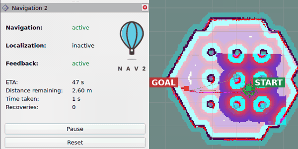

# Use NoDL with Nav2

Use a NoDL-generated client to send a navigation goal to an existing Nav2 system.
Only the client changes; Nav2's servers, planner, controller, and behavior tree stay unchanged.

```text
NoDL-backed goal client ── NavigateToPose ──> unchanged Nav2
```

## 1. Start Nav2

In a workspace with Nav2 and the TurtleBot 3 simulation installed, launch the upstream system:

```bash
export TURTLEBOT3_MODEL=waffle
ros2 launch nav2_bringup tb3_simulation_launch.py headless:=False
```

Use **2D Pose Estimate** in RViz to initialize the robot.
Select **Nav2 Goal**, choose a reachable point, and confirm that the robot moves there.

Leave Nav2 running.



## 2. Use NoDL for the goal client

The example package is `examples/nodl_tutorials/navigate_to_pose_nodl`.
Its client sends one `NavigateToPose` goal.

### `nodl/navigate_to_pose_client.nodl.yaml`

Declare the action client once for both languages:

```{literalinclude} ../../../examples/nodl_tutorials/navigate_to_pose_nodl/nodl/navigate_to_pose_client.nodl.yaml
:language: yaml
```

The action name and type match the interface already provided by Nav2.

### `CMakeLists.txt`

Register the contract, generate a client base, and install the executable.
The highlighted lines are the NoDL additions to the example's `CMakeLists.txt`:

::::{tabs}
:::{group-tab} C++

```{literalinclude} ../../../examples/nodl_tutorials/navigate_to_pose_nodl/CMakeLists.txt
:language: cmake
:lines: 6,8-9,11-23
:emphasize-lines: 2-3,5,7,13
```

The generation input combines the contract with `nodl://nodl_common_interfaces/node`.
Include the generated header as `navigate_to_pose_nodl/navigate_to_pose_client_base.hpp`.

:::

:::{group-tab} Python

```{literalinclude} ../../../examples/nodl_tutorials/navigate_to_pose_nodl/CMakeLists.txt
:language: cmake
:lines: 6-8,10-13,24-31
:emphasize-lines: 2-4,6,8
```

This example uses `ament_cmake_python` so generation runs in the package build.
`NO_INDEX` avoids registering the same contract twice.

:::
::::

### Client implementation

Move the action-client declaration from the constructor into NoDL, then inherit the generated base.
Goal construction, waiting, and result handling stay in the shared `navigation.cpp` or `navigation.py` helper.

::::{tabs}
:::{group-tab} C++

**Before: `src/navigate_to_pose_client.cpp`**

```{literalinclude} ../../../examples/nodl_tutorials/navigate_to_pose_nodl/src/navigate_to_pose_client.cpp
:language: cpp
:start-at: class NavigateToPoseClient
:end-before: int main
```

**After: `src/navigate_to_pose_client_nodl.cpp`**

```{literalinclude} ../../../examples/nodl_tutorials/navigate_to_pose_nodl/src/navigate_to_pose_client_nodl.cpp
:language: cpp
:start-at: class NavigateToPoseClientNodl
:end-before: int main
```

:::

:::{group-tab} Python

**Before: `navigate_to_pose_nodl/navigate_to_pose_client.py`**

```{literalinclude} ../../../examples/nodl_tutorials/navigate_to_pose_nodl/navigate_to_pose_nodl/navigate_to_pose_client.py
:language: python
:start-at: from nav2_msgs.action import NavigateToPose
:end-before: def main
```

**After: `navigate_to_pose_nodl/navigate_to_pose_client_nodl.py`**

```{literalinclude} ../../../examples/nodl_tutorials/navigate_to_pose_nodl/navigate_to_pose_nodl/navigate_to_pose_client_nodl.py
:language: python
:start-at: from nodl_generated.navigate_to_pose_nodl.navigate_to_pose_client_py_base
:end-before: def main
```

:::
::::

The generated base creates `action_cli_navigate_to_pose_` in C++ or `action_cli_navigate_to_pose` in Python.
The navigation behavior stays the same.

## 3. Build, run, and check conformance

### Build

Build and source the example:

```bash
colcon build --packages-up-to navigate_to_pose_nodl
source install/setup.bash
```

### Run and check conformance

Keep Nav2 running.
Source `install/setup.bash` in each new terminal.
Run either client, then check its interface while the robot is moving.
Use `(-2.0, -0.5)` or another reachable goal that takes several seconds to reach.

::::{tabs}
:::{group-tab} C++

```bash
# Terminal 1
ros2 run navigate_to_pose_nodl navigate_to_pose_client_nodl_cpp -2.0 -0.5

# Terminal 2, while the robot is moving
ros2 nodl conform /navigate_to_pose_client \
  --file examples/nodl_tutorials/navigate_to_pose_nodl/nodl/navigate_to_pose_client.nodl.yaml
```

Expected: **`/navigate_to_pose_client: conforms`**.

:::

:::{group-tab} Python

```bash
# Terminal 1
ros2 run navigate_to_pose_nodl navigate_to_pose_client_nodl -2.0 -0.5

# Terminal 2, while the robot is moving
ros2 nodl conform /navigate_to_pose_client_py \
  --file examples/nodl_tutorials/navigate_to_pose_nodl/nodl/navigate_to_pose_client.nodl.yaml
```

Expected: **`/navigate_to_pose_client_py: conforms`**.

:::
::::

The robot should reach the goal through the unchanged Nav2 servers.
Conformance checks the client's declared ROS interface; successful navigation checks that it works with Nav2.

### Run automated checks

The package tests run without the simulator:

```bash
colcon test --packages-select navigate_to_pose_nodl
colcon test-result --verbose
```

They check registration, generated-code snapshots, both Python clients, and live conformance for both generated clients.
Conformance tests start the clients without coordinates so they expose their interfaces without sending a goal.
The conventional C++ client is also compiled to keep the before example valid.
These checks run in CI; they do not test navigation through the simulator.
